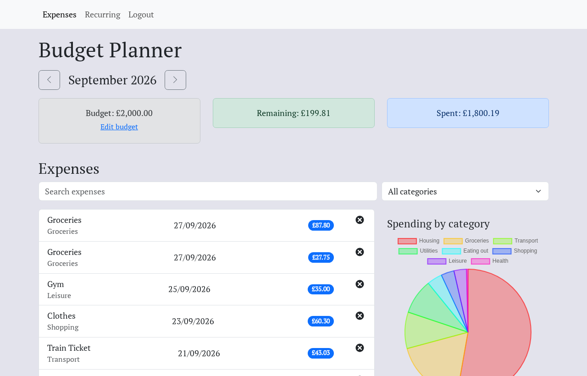
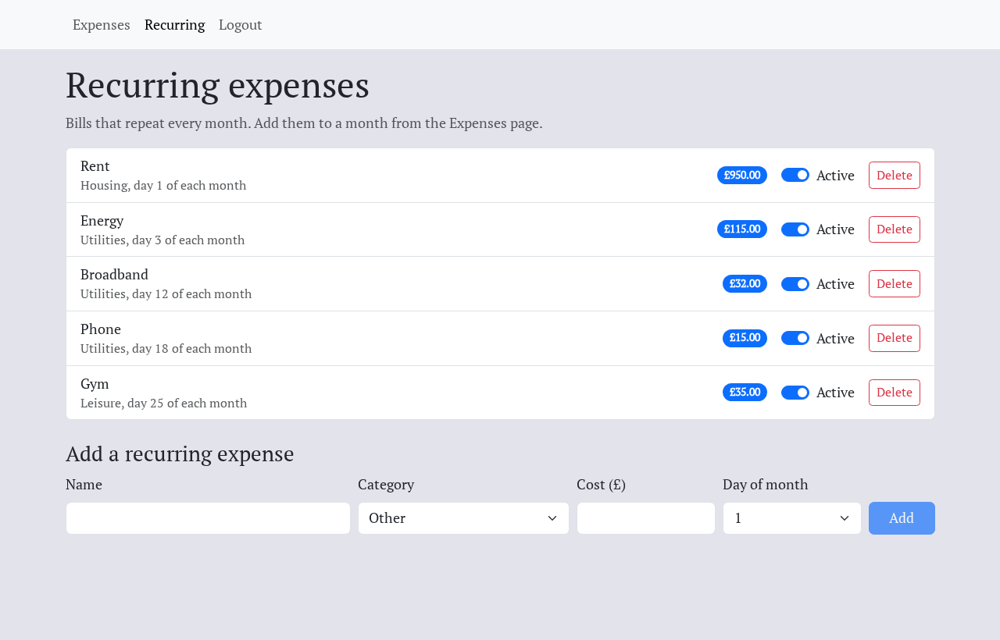

# BudgetFrontend

The web app for **Budget**, a personal budgeting tool: log what you spend, set a monthly budget, and see where the money goes. Built with React 18, TypeScript and Vite, styled with Bootstrap.

It talks to the Django REST API in [BudgetBackend](https://github.com/ElliotRedhead/BudgetBackend).



## Features

- **One month at a time:** move between months. Budget, spent and remaining come from the API's monthly summary.
- **Monthly budget:** set or change it from the page. A month without its own budget shows the one it carries over from.
- **Expenses:** add, edit and delete with a category, cost and date. Times stay in your local time zone.
- **Search and filter** the month by name or category.
- **Spending by category** as a pie chart.
- **Recurring expenses:** manage monthly bills on their own page, then add them to any month in one click.

  

- **CSV export and import** of a month's expenses. Rejected rows are listed with the reason.
- **Accounts** with JWT authentication. An expired access token is refreshed once for all waiting requests, and logging out revokes the refresh token.

## Getting started

### With the backend, in Docker

The quickest way to run everything is from BudgetBackend, with both repositories cloned side by side:

```sh
git clone https://github.com/ElliotRedhead/BudgetBackend.git
git clone https://github.com/ElliotRedhead/BudgetFrontend.git
cd BudgetBackend
docker compose up --build
```

Then open http://localhost:3000 and log in as `demo@example.com` / `demo-budget-2026`.

### On its own

Requires Node 24, and the API running on http://localhost:8000 (see [BudgetBackend](https://github.com/ElliotRedhead/BudgetBackend#api-only-without-docker)).

```sh
cp .env.template .env   # VITE_API_ROOT points at the API
npm install
npm run dev             # http://localhost:3000
```

## Scripts

| Command | What it does |
|---|---|
| `npm run dev` | Vite dev server with hot reloading |
| `npm run build` | Type check and build for production into `dist/` |
| `npm run lint` | ESLint (typescript-eslint, React, React Hooks, jsx-a11y, JSDoc) |
| `npm run typecheck` | TypeScript, without emitting |
| `npm test` | Vitest unit and component tests (add `-- --run` to run once) |
| `npm run e2e` | Playwright end-to-end test against a running API |

## How it's built

- **State:** `ExpenseDataContext` holds the selected month, filters, the paged expense list and the monthly summary in a reducer, and reloads them after any change. `useAxios` wraps requests with loading and error state, turns API errors into readable messages, and refreshes an expired access token once for all waiting requests.
- **Money:** the API works in whole pence. The UI converts to and from pounds only at the edges (`formatPence`, form submission), so no floating-point totals are shown.
- **Dates:** `datetime-local` inputs work in local time and the API in UTC. `dateTimeInput.ts` converts at the boundary, and tests run in `Europe/London` to cover GMT and BST.
- **Tests:** Vitest and Testing Library cover the hooks, context and components, with API calls stubbed. One Playwright test drives a real browser against the real API: register, set a budget, add an expense and delete it. CI runs lint, type checks, unit tests, the build and the end-to-end test, the last against BudgetBackend's `main` branch.

```
src/
├── components/   UI pieces (tiles, list, form, filters, chart, CSV and recurring actions)
├── context/      ExpenseDataContext (month data) and ModalContext (expense form)
├── hooks/        useAxios
├── pages/        Authentication, Expenses and RecurringExpenses
├── utilities/    money, month, date and validation helpers
└── types/        API response types
e2e/              Playwright tests
```

## License

[GPL-3.0](LICENSE)
